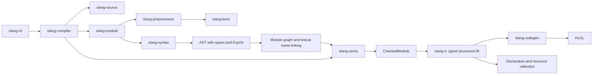

# Architecture

The lexer owns location-independent numeric value parsing shared by semantic
checking and HLSL emission. Decimal float parsing avoids an intermediate double;
half conversion and hexadecimal truncation follow the pinned upstream rules.
The syntax AST retains a parenthesized flag because parentheses limit parser-time
literal folding even when ordinary type checking treats them as transparent.
The constant evaluator uses converted literal values, and target emission
preserves their precision and suffix type. The preprocessor keeps its separate
signed 32-bit number conversion, shared with `#line`.

Local storage normalization runs after aggregate and intrinsic lowering. It
rewrites local static declarations to private global storage with guards at the
original initialization sites. A lexical binding stack keeps shadowed locals and
parameters separate. Unbraced declarations then move their storage to the source
scope while keeping ordinary initialization inside the control body. IR statement
sequences preserve order without introducing a scope; blocks represent scopes.
Reflection selects source globals and excludes this generated storage.

Syntax type applications distinguish type arguments from shape expressions.
Semantic checking resolves numeric applications and their defaults into canonical
vector and matrix types. Constructor callees retain their type application in the
AST; lowering replaces them with the selected canonical constructor. The typed IR
and HLSL emitter therefore use one representation for `vector<float, 3>` and
`float3`.

Module linking resolves names and assigns expression IDs inside type arguments.
Numeric shape checking uses the existing typed scalar constant evaluator. Global
shape dependencies are resolved on demand before declaration signatures are
complete, with cached bindings and bounded cycle checks. Temporary global
bindings preserve local lexical priority, isolate global initializers from caller
locals, and restore the ordinary checker environment after folding. Shape
constants use 64-bit intermediate arithmetic, matching upstream's type-level
folding; ordinary shader constants retain their checked 32-bit or 64-bit types.

User type and function specialization runs between module linking and concrete semantic
checking. The linker gives parameters declaration-scoped names; a mutable AST
visitor substitutes canonical type arguments, renames owned declarations and
assigns fresh expression IDs. A work queue registers nested templates and caches
each concrete application. Alias and shape canonicalization uses the existing
typed constant evaluator with lexical bindings. Expansion has instance, depth and
node budgets; it never invokes the upstream compiler.

Cloned declarations preserve source byte coordinates and receive an instantiation
context in `Span`. Semantic declaration maps use source, start, end and context,
so two specializations cannot overwrite their field types or initialization plans.
`Module.generic_instances` records argument types visible in each context,
including captured enclosing arguments. This allows imported templates to use
caller-defined types while retaining module isolation for ordinary values.
An isolated symbolic pass first instantiates every template with distinct opaque
parameter types and runs ordinary semantic checking, including on unused bodies.
Numeric shapes with opaque components have private semantic struct identities;
their selectors and indexes preserve the component type, while arithmetic has no
witness and fails. Copy/default parameter constructors retain their source origin,
so `T()` can lower to default initialization after substitution without allowing
unsupported empty calls to concrete numeric constructors.
Unconstrained parameter construction uses checked recursive zero initialization
or an exact value copy before user constructor selection or constant-buffer loads.
Aggregate zero plans omit field defaults, and their expansion uses the same depth
and node budgets as ordinary default initialization.
Parameter copy casts retain this origin too; the checker records a value
initialization plan that lowering consumes without emitting resource or aggregate
HLSL casts. Synthesized receiver and constructor-result owner references survive
outer substitutions until their nested owner is specialized. Symbolic declarations
are discarded. The concrete declarations use ordinary checking, layout and HLSL
lowering. General constrained validation, witness tables and IR-level generic
specialization remain unimplemented.
Function parameter bindings use declaration-scoped indexed names so prototypes
can rename parameters without changing substitution. The linker distinguishes
generic function applications from type construction and local value comparisons.
Function applications retain candidate sets in `Module.function_applications`;
subsequent call checking selects concrete signatures and initialization/output plans.
Each generic overload has a separate template and instance cache entry, while
canonical source signatures join prototypes to definitions. The first declaration
owns its type defaults. Concrete conversion cost and the number of default type
arguments rank applicable candidates, and equal scores produce call ambiguity.
Selected calls lower to the concrete function name; application aliases never
reach emitted HLSL. Each specialization
retains fresh expression IDs and a span context, while aliases share cached
applications. A symbolic pass checks every function template before any concrete
body is lowered. Deferred generic calls retain their callee IDs and supplied type
arguments in the specializer. Ordinary semantic probes collect value-argument
types while unresolved calls temporarily have error types. Structural matching
infers parameters before defaults; concrete candidate signatures are validated
before instantiation. New declarations and nested calls repeat this bounded
process. Symbolic numeric shapes are reconstructed with their opaque components,
while instance metadata retains template identity and own/captured argument counts.
A fresh complete semantic check validates the final module before lowering.
Bare calls combine ordinary and generic candidates, preferring ordinary overloads
on equal costs. Explicit calls restrict the candidates to generic functions.
Generated declarations begin dormant: probes declare candidate signatures while
skipping their bodies, parameter defaults and data initializers. Selected call
targets and recursive constructor initialization plans activate functions;
references from ordinary and active declarations activate type/static dependencies.
Inference and activation repeat together until no new declarations or calls are
needed. Active ambiguities are preserved before dormant declarations and their
metadata are pruned. Capability validation runs in the final complete check.
Complete constrained resolution remains unimplemented.
Shape conversions between different scalar types apply the destination's bit
width. Identity constructors preserve wider shape intermediates, following
`TypeCastIntVal::tryFoldImpl`; implicit global and local initializers follow
the same conversion rule. Thus `uint16_t(65538)` is two, while an identity
constructor around a widened uint16 arithmetic result preserves that result.
Unsigned 64-bit constants store their bit pattern in signed storage; division,
remainder, comparisons and right shifts interpret it through the checked type.
Literal width and signed-minimum selection are shared between syntax checking
and IR lowering. Target integer literals explicitly preserve the selected width.
Pointer integer identities survive semantic checking and reflection. Arithmetic
unification uses component byte sizes and operand order; generic inference joins
by scalar conversion costs. The HLSL backend maps pointer integers to its 64-bit
target width, and uniform layouts use eight-byte components. Typed numeric
constructor nodes preserve pointer shapes without inventing core vector aliases.

Native 16-bit integer identities use two-byte storage and truncating constants.
Profile resolution chooses one physical mode for the whole emitted module;
the IR and reflection retain it. Default half-only compilations preserve legacy
four-byte storage. Native uniform matrix views store vectors at the checked
source offsets, avoiding DXC's direct-matrix tail padding. Register-aligned
padding structs address fields in the second half of four-byte components.
Native scalar shifts clamp unsigned counts at 16 before shifting promoted
operands, matching pinned SCCP zero/sign saturation and evaluating each input
once. Proven scalar local compound shifts fold through SSA propagation;
indexed compound shifts retain native destination syntax and runtime DXC behavior.

Arithmetic normalization runs after local storage normalization and scalar SSA
propagation, before resource storage lowering.
It converts wide binary operands, conditional branches and arithmetic intrinsic
inputs to their checked types. Compound assignments convert only the right
operand to the destination type, preserving the native compound expression so
DXC evaluates an indexed destination once. Shift count types stay independent.

Matrix storage qualifiers are separate from algebraic matrix value types.
Semantic checking records declaration and alias layouts and normalizes qualified
structured-buffer elements against the compilation default. `CheckedModule`
carries that default through IR generation and reflection. Uniform type layouts
cache distinct row-major matrix and array entries. Aggregate loading reconstructs
matrix arrays when DXC cannot safely copy their storage order; structured-buffer
helpers evaluate the source index once and preserve writable locations. Qualified
numeric resource elements lower to one-field HLSL storage structs.

Constant-buffer checking distinguishes resource expressions from implicit value
loads. `CheckedModule.constant_buffer_loads` records selected expression IDs;
coercion preserves handles for exact resource parameters and returns. Lowering
creates `ConstantBufferLoad` IR expressions. A late pass, after source layout
and matrix/packing normalization, wraps nonstruct elements in HLSL storage
structs and resolves those loads. Whole-array helpers reconstruct logical values
while evaluating the handle once; direct indexing avoids materializing the
array. Void storage structs have no fields and their load helpers preserve
argument evaluation. Source reflection is captured before storage type rewriting.

Atomic normalization adds a private typed output when Slang omits the old value
of an exchange. HLSL requires that output. Its per-invocation scalar storage is
declared before source globals so global initializers can also use it. The atomic
destination stays in the original call, and generated storage is excluded from
source reflection.

## Compilation flow

All phases share `slang-source`. The diagram shows the main data flow; each
crate's `Cargo.toml` defines the exact dependency graph.

## Crate responsibilities

| Crate | Input | Output | Responsibility |
| --- | --- | --- | --- |
| slang-source | UTF-8 text | SourceId, Span, Diagnostic | Source ownership and error locations |
| slang-layout | Binding descriptions | Shared register models | Register classes, spaces, contiguous resource ranges |
| slang-lexer | UTF-8 and SourceId | Tokens and diagnostics | Token recognition without grammar |
| slang-preprocessor | File, resolver, definitions | Expanded tokens | Macros and include state |
| slang-syntax | Expanded tokens | Module or diagnostics | Grammar and precedence |
| slang-module | Root source, resolver, definitions | Program or diagnostics | Module graph, member files, visibility-aware names |
| slang-sema | Linked Program | CheckedModule or diagnostics | Types, overload visibility, writable locations, entry points |
| slang-ir | CheckedModule | Typed Module | Lowering away syntax details |
| slang-codegen | IR and Target | Code or diagnostic | Target-specific generation |
| slang-compiler | Source and CompileOptions | Compilation or CompileError | Public API and phase coordination |
| slang-cli | OS arguments | Files, stdout, exit status | External command-line interface |

## Sources and diagnostics

`SourceMap` owns immutable text through `Arc<str>`. A `SourceId` identifies a file
within one compilation. `Span` is a half-open range of **byte offsets**. Rendered
physical locations use one-based lines and Unicode scalar columns. Include diagnostics
retain the included file's source ID. Macro body tokens receive the invocation
span; a complete macro origin stack remains to be implemented.

Each source file stores an ordered table of line mappings at directive keyword
offsets. `location` remains physical; `presumed_location` selects the displayed
filename and applies a wrapping signed 32-bit line adjustment. Diagnostic rendering
uses presumed coordinates with a physical source excerpt. Preprocessing clears
old mappings when a source is processed again. Line directive argument parsing
and filename decoding belong to `slang-preprocessor`; source mapping does not
depend on tokens. Physical names continue to drive all file resolution.

Location macros retain a separate initiating span through expansion queues and
argument rescanning. This gives nested `__LINE__` and `__FILE__` the outer source
call's location while preserving the emitted token's diagnostic span. Builtins
are entries in the preprocessing environment, so normal redefinition and undef
operations affect them. The compiler adds the default Slang language define
before loading modules; imported preprocessing environments remain isolated.

`Diagnostic` contains severity, code, message, span, and notes. Internal codes
are independent of upstream's numeric diagnostic IDs. The public pipeline never
reports successful compilation after an error. `--check` runs through IR
lowering without invoking a backend.

## Syntax and IR

The parsed AST retains source type names, attributes, spans, and expression IDs.
Single local variable declarations are boxed inside statement nodes to keep
recursive parser frames small on the Windows debug stack.
The module linker assigns unique declaration names and expression IDs across
all loaded ASTs, preserving lexical scopes and source ownership. `Program`
records the module graph and each canonical declaration's source name and owner.
Lexical scopes map source names to their selected bindings. Locals that could
capture an outer target name receive unique canonical names after resolving
their initializers. Their source names remain in symbol metadata for diagnostics;
duplicate declarations in one scope still map to the same name and are rejected.
Semantic checking resolves types into expression and declaration tables.
Global initializers are checked before function attributes and bodies. Integer
and boolean global constants then resolve through a reverse-dependency worklist;
an iterative graph walk diagnoses structural initializer cycles without recursing
on the native stack. Resolved references use declaration spans, including across
module boundaries. Function attributes resolve before parameters enter scope.
`CheckedModule.global_constants` stores the checked scalar values, and IR lowering
replaces their initializers with typed literals so forward references also produce
valid HLSL. Floating expressions stay outside the integer cache to preserve their
fractional values.
Type aliases resolve through a compilation-local cache with cycle detection.
They disappear during lowering, leaving canonical scalar, aggregate, and resource
types. Array types record outer-to-inner dimensions independently of whether
the source used leading or trailing array declarators.

Register annotations retain a separate AST node and source span; register tokens
never enter lexical symbol resolution or expression checking. `slang-layout`
defines the shared register class, index, space, and checked resource range
without depending on syntax or types. Semantic checking validates each global
resource's class after resolving aliases, computes array register counts, and
records the result in `CheckedModule.resource_bindings`. A sorted range sweep
diagnoses overlaps without expanding arrays or enumerating all pairs. Successful
checked modules retain warnings separately from errors. IR variables receive
the checked range, which HLSL emission and reflection both use. Generated
variables have no resource binding. `RegisterAllocator` merges occupied ranges
and selects the first contiguous free range without expanding arrays. Explicit
annotations reserve their ranges before automatic allocation. Ordinary global
uniforms reserve an implicit constant-buffer slot; resource allocation then
follows root-module declarations and module discovery order, independent of
the linker's dependency-first emission order. Every allocated source resource
keeps its range even if unused. Byte layout remains unimplemented.
Bit reinterpretation signatures record the selected component type and shape.
Boolean and half inputs lower through explicit casts before reinterpretation;
identity operations reduce to their input expression. Double word outputs retain
their writable argument types, including signed integers, instead of receiving
casts that would turn them into temporary values.
One-component vectors retain their shape in the type tables and matrix row
indexing. Overload groups involving these shapes receive distinct target names
because HLSL may treat a one-component vector as its scalar component. Generated
names reserve global, parameter, and local declarations to avoid lexical capture.
Lowering checks that this information exists and attaches a type to each IR
expression.

Geometric signatures infer components and matching vector dimensions
before lowering. Cross-product signatures additionally select integer overloads
and fixed three-component parameters. `slang-ir::geometric` caches integer cross
helpers by component type, reserving generated names against existing bindings.
Their vector swizzles multiply and subtract without passing through HLSL's
floating cross intrinsic. Other double geometric calls explicitly narrow their inputs
to the target float instructions and convert results back to the checked shape.
Integer and double dot products use typed component reductions in cached helpers
keyed by operation and parameter shape. The supplied expressions remain call
arguments, while helper parameters supply the component products and ordered sums.
These reductions retain integer or double arithmetic instead of HLSL dot instructions.

Global declaration groups are parsed into individual declarations; struct groups
become ordered fields. Local groups use `Variables` nodes in AST and typed IR
to retain sequential bindings without introducing a block scope. The HLSL
backend emits independent declarations, placing grouped `for` initializers in
an enclosing block that preserves the source loop's lifetime and array types.

`CheckedModule` also records normalized construction plans. The semantic
checker preserves struct field order, resolves omitted defaults, and makes
zero-initialized leaves explicit. Typed IR removes field initializers from
declarations and lowers memberwise construction to generated functions with
field and array-element writes. Helper names avoid source bindings; supplied
values occur once in the call arguments. Copy construction lowers directly to
the copied value. Bounded expansion detects recursive constructor defaults.

Initializer lists remain context-dependent in the AST. Checking records a
concrete normalized plan after selecting a target. Numeric construction retains
vector operands as single values, and array plans include every omitted element.
IR lowers array expressions through private wrapper structs and constructor
functions, allowing HLSL to represent arrays in assignments and call arguments.
Generated wrappers are excluded from source declaration reflection. A shared
expansion budget bounds nested field defaults during lowering, including finite
defaults whose expansion branches repeatedly.

Value-type validation uses an iterative depth-first traversal with cached struct
depths. Shared subgraphs are checked once, cycles propagate to their embedding
types, and structures deeper than 128 levels receive a source-located diagnostic.
The traversal does not consume the native thread stack.

Function signatures retain checked default expressions across prototypes and
definitions. Selected calls record only the omitted arguments; IR makes the
full argument list explicit and removes defaults from target parameter
declarations. Default expressions lower into private functions in declaration
scope so caller-local names cannot capture global references. Their generated
names avoid all source bindings. Struct field defaults use the same
declaration-scope helpers, including defaults inside nested arrays and lists.
Defaults and aggregate construction share
cycle, depth, and expansion budgets.

Stage requirements are discovered in checked expressions and propagated over
the selected overload graph using reverse edges and a worklist. Scanning also
follows used globals and normalized omitted defaults, with expression IDs
preventing recursive default traversal. Resolved global references identify their
declarations by span rather than spelling, preserving local shadowing even when
using the semantic checker directly without the module linker. Globals without
initializers still carry their storage requirements. Independent fragment and
compute requirements merge monotonically through cyclic call graphs. Invalid
entries receive diagnostics at the original operation, including imported source
spans. The current set covers `discard`, `clip`, groupshared storage, and memory
barriers that use a thread group; a device barrier without group synchronization
does not impose a compute requirement.

Derivative requirements remain separate from fragment-only operations because
compute supports them with suitable quad dimensions and target capabilities.
Checking validates the dimensions and retains source-located requirements in
`CheckedModule`. Profile resolution in `slang-compiler` selects HLSL profiles,
upgrades compute derivatives to shader model 6.6, and records the result in
reflection. Semantic checking therefore does not depend on an HLSL profile.
Coarse/fine fwidth lowering uses cached typed helpers with a single input;
double derivatives explicitly narrow to HLSL float instructions and convert
their results back to the checked type.

Output intrinsic signatures infer input conversions from supplied output types,
then require exact writable outputs. IR makes the selected intrinsic and resource
input conversions explicit so backend overload resolution preserves the checked
type and shape, including scalar splats.

`IntrinsicCall` nodes keep selected builtins separate from user calls. HLSL
renames user declarations that share builtin spellings while preserving native
intrinsic calls. Matrix sincos, modf, and frexp use generated functions that call
vector overloads row by row. Helpers are cached by intrinsic, scalar type, and
matrix dimensions. Typed passes share a visitor and iterative binding-name
collection; aggregate normalization runs before matrix intrinsic lowering.

Vector and matrix component selectors share a dedicated semantic module.
Matrix selectors normalize zero-based and one-based coordinates for bounds and
writability checks while retaining their source spelling in typed IR. A repeated
component can be read but cannot form an output location. The HLSL emitter keeps
the selector on the original matrix expression, including resource elements and
shared atomic destinations.

Imported function overloads receive distinct target names when needed. The
checker records the selected callable in `CheckedModule`; lowering uses that
selection so target compilation cannot select an internal overload by mistake.
See [modules.md](modules.md) for file membership, access rules, and remaining limits.

User `__init` declarations become function AST nodes with an owning struct type
and a generated source name that cannot collide with source identifiers. The
module resolver preserves unqualified field names inside constructor bodies
while resolving the owner type, globals and parameter defaults in their module.
Semantic checking records the receiver type for implicit member expressions,
selected constructor identities, declaration defaults, and automatic variable
and nested-field initialization plans. Constructor overloads retain declaration
identities rather than merging prototypes with definitions. Constructors and
ForceInline overloads receive distinct target names so inlining uses the selected
body even when HLSL could represent their signatures directly.

`InitializationKind::ConstructorCall` carries the selected target, parameter
types and argument plans for contextual lists and automatic construction.
Output arguments retain their writable source types. IR lowering allocates an
uninitialized `this` receiver, applies declared field defaults and nested struct
construction, then lowers the body. Bare and fallthrough returns return `this`;
explicit value returns retain their checked expression. Unwritten fields and
arrays without explicit initializers are not filled with zeros. Capability
analysis follows constructor calls and automatic/default initialization plans.
Static const global initializer checking follows expression and initialization
graphs, rejecting mutable global storage and ordinary user calls without executing
their bodies. Normalized struct static fields retain ownership metadata, preserving
the upstream exemption for member initializers and references to member storage.

Struct method AST nodes retain their owning type, source member name and static
mode. Instance methods have a leading normalized `this` parameter: a const input
for ordinary/nonmutating methods or an inout parameter for mutating methods.
Generated method names encode the owner length to distinguish owner/member names
with underscores. Module resolution preserves the member namespace through
imports and keeps source fields and method names ahead of globals.

Method overload selection ranks explicit arguments without the hidden receiver.
Static and instance signatures retain separate identities even when their lowered
parameter types coincide. The selected call records an explicit, implicit or
absent receiver in `CheckedModule.method_receivers`. Lowering prepends the receiver
to an ordinary typed call, allowing existing argument capture, output addressing,
array-result wrappers, effect normalization and SSA invalidation to apply.
Nonmutating receiver fields use the const binding's writability. Static calls
discard the base expression, and capability analysis also excludes that base
while following the selected method body and explicit/default arguments.

Static field declarations normalize to collision-free globals while
`Module.static_members` retains the owner and source member name. The resolver
uses separate static/full member namespaces for signatures, field defaults and
bodies. Semantic checking maintains an owning static context independently of
the implicit instance receiver, including during isolated forward shape folding.
`CheckedModule.static_references` identifies the real storage target without
lowering the lookup base. Integer constants, writable locations, initializer
dependencies and capability propagation use that target. Reflection restores
qualified names, and all instance layout paths see only nonstatic fields.
Global constant IR operands and their upstream folding/hoisting behavior remain
unported; native nonfoldable static const values keep private HLSL initialization.

Nested structs and aliases also flatten to collision-free declarations;
`Module.nested_types` preserves each owner, source name and target type name.
Module fragments carry both type and static-member metadata. Linking resolves
the qualified base and enclosing lexical scopes, while semantic lookup checks
each selected member's visibility. Alias resolution restores its declaration
scope, including forward shape constants and matrix storage qualifiers.
`CheckedModule.static_type_lookups` marks unevaluated nested type selections,
allowing constructors through a value base without its side effects, initializer
dependencies, default-parameter dependencies or capability requirements.
Nested instance methods use their own receiver; enclosing instance members do
not acquire one. Parser declaration depth and alias/value graph limits bound
recursive inputs.

Explicit `[ForceInline]` requests expand ordinary value function bodies before
SSA construction. Prototypes and definitions use their checked target names;
overloads and imported declarations retain the selected callable. Fresh local
storage captures every argument in source order, including unused inputs, and
preserves local parameter writes. Linear bodies use balanced comma expressions.
Bodies with control flow use temporary statement expressions, unique result and
returned-flag storage, guarded following statements, and loop conditions that
stop after return. Cloning follows source lexical scopes, shared switch scopes,
and for-loop bindings. Normalized static locals retain the same backing globals.
Source global references stay distinct from renamed local/parameter bindings.

Expression-effect normalization removes every statement expression before SSA.
Earlier input values are captured before later statement regions, while writable
storage paths retain their evaluated indexes and resource handles. Compound
destinations load their contents after the right operand. The checker records
output positions and the selected callee for user calls, intrinsics, and resource
methods; generated helpers supply their own signatures. Short-circuit operands
and conditional arms become guarded statement regions. Lifted while conditions
execute at the loop head. For increments and do/while conditions use a first
iteration flag at the loop head, so continue targets still execute the correct
increment or condition. Aggregate captures receive ordinary initialization
lowering before SSA. Expansion has node/depth limits and rejects shared/volatile
local storage and statement-valued vector condition regions. Ordinary calls
remain opaque to SCCP, matching the tested upstream optimization boundary.

Out/inout expansion retains direct address aliases or uses ordered scratch
copy-back for swizzles and resource setters. Same-width integral output views
preserve the declared load/store type through expression-effect normalization.
Global initializers containing requested inline calls move their captures and
statement regions into generated initializer functions. A second array-result
pass wraps fixed-array returns from these functions before effect normalization,
keeping all lifted statements inside function bodies.

Struct and fixed-array inputs use captured copies; array results use the existing
return wrapper before inlining. Resource captures preserve handles. Aggregate
local initialization and result assignment use ordinary initialization lowering.
Void expansion has no result storage. Empty bodies still capture every input,
early void returns set the same returned flag, and normalization removes the
temporary no-value expression from standalone calls, comma operands, void
conditionals, and returned void calls. Dynamic ConstantBuffer selection still
needs target lowering before HLSL value loads can be emitted reliably.

Target emission consumes **structured** IR: blocks, conditions, and loops remain
explicit nodes. `slang_ir::flow` builds a separate typed scalar SSA graph after
local storage normalization. Each lexical integer or boolean local has its own
identity. Block arguments merge reaching values at branches and loop backedges;
conditional and short-circuit expressions also have result parameters. Explicit
edges preserve switch fallthrough, break, continue, returns, and discarded paths.

The verifier checks value definitions, operand IDs, edge argument counts and
types, immediate dominance, and same-block definition order. Sparse conditional
constant propagation tracks unknown, constant, and dynamic values, revisiting
executable blocks through use-def lists. Only executable predecessors contribute
to parameter meets. Uninitialized storage and opaque loads/calls are dynamic;
constant loops do not receive a guessed iteration count.

Substitution preserves writes and evaluation order in structured IR. A proven
scalar compound value becomes an assignment, retaining a side-effecting right
operand through a comma expression. The inout operand is loaded after right
argument evaluation. Call output locations are never replaced with literals;
out/inout calls invalidate their scalar values. Aggregate and indexed locations,
shared or volatile storage, floating values, and call execution remain outside
scalar propagation. An optional size budget skips optimization for large
functions without rejecting compilation. Temporary tree addresses associate
analysis results with expressions only within this pass; graphs expose stable
value/block indices, not addresses.

Memory SSA, aggregate propagation, general IR specialization, IR linking, canonicalization,
and the full upstream pass pipeline remain unimplemented. Backends must not
depend on the AST or semantic checker.

## Backend boundaries

Legacy HLSL uniform packing arithmetic and reflection models live in
`slang-layout`, independent of syntax and semantic types. After typed lowering,
`slang-ir` visits the required constant-buffer value graph with an explicit stack
and caches each canonical type layout. Fields and array elements reference those
cached layouts, avoiding expansion of shared graphs and large arrays. Global
offsets follow root-module and import discovery order. Checked 64-bit arithmetic
reports layout overflow at the source global. The HLSL emitter preserves that
global order and fixes column-major matrix packing; declaration reflection copies
the same layout metadata. Other targets will require their own layout policies.

The HLSL emitter writes structures, function signatures, globals, and function
bodies. It preserves names and system semantics, uses four-space indentation,
and inserts parentheses to preserve evaluation order. Its `names` module maps
HLSL-reserved identifiers consistently across declarations, types, references,
and fields, preserving distinct source names. Reflection exposes target names
for entries and globals. Slang's `shader` attribute
becomes entry-point metadata, while `numthreads` remains an HLSL attribute.

Each new backend belongs in its own module under `slang-codegen`. A backend is
not considered implemented until independent validators and differential tests
verify its artifacts. Capability checking and resource layout must precede
support for advanced resources and target features.

## State and concurrency

Each `compile_source` call owns its compilation state. There are no global
macros, mutable shared caches, or dynamic upstream compiler calls. Independent
calls may run concurrently when the caller's resolver supports that usage.
Individual compilation phases currently run sequentially.
