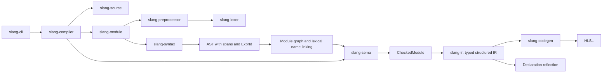

# Architecture

## Compilation flow

All phases share `slang-source`. The diagram shows the main data flow; each
crate's `Cargo.toml` defines the exact dependency graph.

## Crate responsibilities

| Crate | Input | Output | Responsibility |
| --- | --- | --- | --- |
| slang-source | UTF-8 text | SourceId, Span, Diagnostic | Source ownership and error locations |
| slang-lexer | UTF-8 and SourceId | Tokens and diagnostics | Token recognition without grammar |
| slang-preprocessor | File, resolver, definitions | Expanded tokens | Macros and include state |
| slang-syntax | Expanded tokens | Module or diagnostics | Grammar and precedence |
| slang-module | Root source, resolver, definitions | Program or diagnostics | Module graph, member files, visibility-aware names |
| slang-sema | Linked Program | CheckedModule or diagnostics | Types, overload visibility, writable locations, entry points |
| slang-ir | CheckedModule | Typed Module | Lowering away syntax details |
| slang-codegen | IR and Target | Code or diagnostic | Target-specific generation |
| slang-compiler | Source and CompileOptions | Compilation or CompileError | Public API and phase coordination |
| slang-cli | OS arguments | Files, stdout, exit status | External command-line interface |

## Sources and diagnostics

`SourceMap` owns immutable text through `Arc<str>`. A `SourceId` identifies a file
within one compilation. `Span` is a half-open range of **byte offsets**. Rendered
locations use one-based lines and Unicode scalar columns. Include diagnostics
retain the included file's source ID. Macro body tokens receive the invocation
span; a complete macro origin stack remains to be implemented.

`Diagnostic` contains severity, code, message, span, and notes. Internal codes
are independent of upstream's numeric diagnostic IDs. The public pipeline never
reports successful compilation after an error. `--check` runs through IR
lowering without invoking a backend.

## Syntax and IR

The parsed AST retains source type names, attributes, spans, and expression IDs.
The module linker assigns unique declaration names and expression IDs across
all loaded ASTs, preserving lexical scopes and source ownership. `Program`
records the module graph and each canonical declaration's source name and owner.
Semantic checking resolves types into expression and declaration tables.
Type aliases resolve through a compilation-local cache with cycle detection.
They disappear during lowering, leaving canonical scalar, aggregate, and resource
types. Array types record outer-to-inner dimensions independently of whether
the source used leading or trailing array declarators.
Lowering checks that this information exists and attaches a type to each IR
expression.

`CheckedModule` also records normalized construction plans. The semantic
checker preserves struct field order, resolves omitted defaults, and makes
zero-initialized leaves explicit. Typed IR removes field initializers from
declarations and lowers memberwise construction to generated functions with
field and array-element writes. Helper names avoid source bindings; supplied
values occur once in the call arguments. Copy construction lowers directly to
the copied value. Bounded expansion detects recursive constructor defaults.

Initializer lists remain context-dependent in the AST. Checking records a
concrete normalized plan after selecting a target. Numeric construction retains
vector operands as single values, and array plans include every omitted element.
IR lowers array expressions through private wrapper structs and constructor
functions, allowing HLSL to represent arrays in assignments and call arguments.
Generated wrappers are excluded from source declaration reflection. A shared
expansion budget bounds nested field defaults during lowering, including finite
defaults whose expansion branches repeatedly.

Imported function overloads receive distinct target names when needed. The
checker records the selected callable in `CheckedModule`; lowering uses that
selection so target compilation cannot select an internal overload by mistake.
See [modules.md](modules.md) for file membership, access rules, and remaining limits.

The current IR is **structured**: blocks, conditions, and loops remain explicit
nodes. SSA, CFG construction, dominance, phi nodes, specialization, IR linking,
and optimization passes have not been implemented. They belong in a subsequent
IR layer. Backends must not depend on the AST or semantic checker.

## Backend boundaries

The HLSL emitter writes structures, function signatures, globals, and function
bodies. It preserves names and system semantics, uses four-space indentation,
and inserts parentheses to preserve evaluation order. Its `names` module maps
HLSL-reserved identifiers consistently across declarations, types, references,
and fields, preserving distinct source names. Reflection exposes target names
for entries and globals. Slang's `shader` attribute
becomes entry-point metadata, while `numthreads` remains an HLSL attribute.

Each new backend belongs in its own module under `slang-codegen`. A backend is
not considered implemented until independent validators and differential tests
verify its artifacts. Capability checking and resource layout must precede
support for advanced resources and target features.

## State and concurrency

Each `compile_source` call owns its compilation state. There are no global
macros, mutable shared caches, or dynamic upstream compiler calls. Independent
calls may run concurrently when the caller's resolver supports that usage.
Individual compilation phases currently run sequentially.
