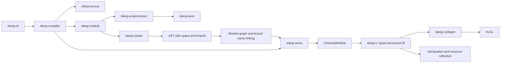

# Architecture

Local storage normalization runs after aggregate and intrinsic lowering. It
rewrites local static declarations to private global storage with guards at the
original initialization sites. A lexical binding stack keeps shadowed locals and
parameters separate. Unbraced declarations then move their storage to the source
scope while keeping ordinary initialization inside the control body. IR statement
sequences preserve order without introducing a scope; blocks represent scopes.
Reflection selects source globals and excludes this generated storage.

Syntax type applications distinguish type arguments from integer shape arguments.
Semantic checking resolves numeric applications and their defaults into canonical
vector and matrix types. Constructor callees retain their type application in the
AST; lowering replaces them with the selected canonical constructor. The typed IR
and HLSL emitter therefore use one representation for `vector<float, 3>` and
`float3`.

Matrix storage qualifiers are separate from algebraic matrix value types.
Semantic checking records declaration and alias layouts and normalizes qualified
structured-buffer elements against the compilation default. `CheckedModule`
carries that default through IR generation and reflection. Uniform type layouts
cache distinct row-major matrix and array entries. Aggregate loading reconstructs
matrix arrays when DXC cannot safely copy their storage order; structured-buffer
helpers evaluate the source index once and preserve writable locations. Qualified
numeric resource elements lower to one-field HLSL storage structs.

Atomic normalization adds a private typed output when Slang omits the old value
of an exchange. HLSL requires that output. Its per-invocation scalar storage is
declared before source globals so global initializers can also use it. The atomic
destination stays in the original call, and generated storage is excluded from
source reflection.

## Compilation flow

All phases share `slang-source`. The diagram shows the main data flow; each
crate's `Cargo.toml` defines the exact dependency graph.

## Crate responsibilities

| Crate | Input | Output | Responsibility |
| --- | --- | --- | --- |
| slang-source | UTF-8 text | SourceId, Span, Diagnostic | Source ownership and error locations |
| slang-layout | Binding descriptions | Shared register models | Register classes, spaces, contiguous resource ranges |
| slang-lexer | UTF-8 and SourceId | Tokens and diagnostics | Token recognition without grammar |
| slang-preprocessor | File, resolver, definitions | Expanded tokens | Macros and include state |
| slang-syntax | Expanded tokens | Module or diagnostics | Grammar and precedence |
| slang-module | Root source, resolver, definitions | Program or diagnostics | Module graph, member files, visibility-aware names |
| slang-sema | Linked Program | CheckedModule or diagnostics | Types, overload visibility, writable locations, entry points |
| slang-ir | CheckedModule | Typed Module | Lowering away syntax details |
| slang-codegen | IR and Target | Code or diagnostic | Target-specific generation |
| slang-compiler | Source and CompileOptions | Compilation or CompileError | Public API and phase coordination |
| slang-cli | OS arguments | Files, stdout, exit status | External command-line interface |

## Sources and diagnostics

`SourceMap` owns immutable text through `Arc<str>`. A `SourceId` identifies a file
within one compilation. `Span` is a half-open range of **byte offsets**. Rendered
physical locations use one-based lines and Unicode scalar columns. Include diagnostics
retain the included file's source ID. Macro body tokens receive the invocation
span; a complete macro origin stack remains to be implemented.

Each source file stores an ordered table of line mappings at directive keyword
offsets. `location` remains physical; `presumed_location` selects the displayed
filename and applies a wrapping signed 32-bit line adjustment. Diagnostic rendering
uses presumed coordinates with a physical source excerpt. Preprocessing clears
old mappings when a source is processed again. Line directive argument parsing
and filename decoding belong to `slang-preprocessor`; source mapping does not
depend on tokens. Physical names continue to drive all file resolution.

Location macros retain a separate initiating span through expansion queues and
argument rescanning. This gives nested `__LINE__` and `__FILE__` the outer source
call's location while preserving the emitted token's diagnostic span. Builtins
are entries in the preprocessing environment, so normal redefinition and undef
operations affect them. The compiler adds the default Slang language define
before loading modules; imported preprocessing environments remain isolated.

`Diagnostic` contains severity, code, message, span, and notes. Internal codes
are independent of upstream's numeric diagnostic IDs. The public pipeline never
reports successful compilation after an error. `--check` runs through IR
lowering without invoking a backend.

## Syntax and IR

The parsed AST retains source type names, attributes, spans, and expression IDs.
Single local variable declarations are boxed inside statement nodes to keep
recursive parser frames small on the Windows debug stack.
The module linker assigns unique declaration names and expression IDs across
all loaded ASTs, preserving lexical scopes and source ownership. `Program`
records the module graph and each canonical declaration's source name and owner.
Lexical scopes map source names to their selected bindings. Locals that could
capture an outer target name receive unique canonical names after resolving
their initializers. Their source names remain in symbol metadata for diagnostics;
duplicate declarations in one scope still map to the same name and are rejected.
Semantic checking resolves types into expression and declaration tables.
Global initializers are checked before function attributes and bodies. Integer
and boolean global constants then resolve through a reverse-dependency worklist;
an iterative graph walk diagnoses structural initializer cycles without recursing
on the native stack. Resolved references use declaration spans, including across
module boundaries. Function attributes resolve before parameters enter scope.
`CheckedModule.global_constants` stores the checked scalar values, and IR lowering
replaces their initializers with typed literals so forward references also produce
valid HLSL. Floating expressions stay outside the integer cache to preserve their
fractional values.
Type aliases resolve through a compilation-local cache with cycle detection.
They disappear during lowering, leaving canonical scalar, aggregate, and resource
types. Array types record outer-to-inner dimensions independently of whether
the source used leading or trailing array declarators.

Register annotations retain a separate AST node and source span; register tokens
never enter lexical symbol resolution or expression checking. `slang-layout`
defines the shared register class, index, space, and checked resource range
without depending on syntax or types. Semantic checking validates each global
resource's class after resolving aliases, computes array register counts, and
records the result in `CheckedModule.resource_bindings`. A sorted range sweep
diagnoses overlaps without expanding arrays or enumerating all pairs. Successful
checked modules retain warnings separately from errors. IR variables receive
the checked range, which HLSL emission and reflection both use. Generated
variables have no resource binding. `RegisterAllocator` merges occupied ranges
and selects the first contiguous free range without expanding arrays. Explicit
annotations reserve their ranges before automatic allocation. Ordinary global
uniforms reserve an implicit constant-buffer slot; resource allocation then
follows root-module declarations and module discovery order, independent of
the linker's dependency-first emission order. Every allocated source resource
keeps its range even if unused. Byte layout remains unimplemented.
Bit reinterpretation signatures record the selected component type and shape.
Boolean and half inputs lower through explicit casts before reinterpretation;
identity operations reduce to their input expression. Double word outputs retain
their writable argument types, including signed integers, instead of receiving
casts that would turn them into temporary values.
One-component vectors retain their shape in the type tables and matrix row
indexing. Overload groups involving these shapes receive distinct target names
because HLSL may treat a one-component vector as its scalar component. Generated
names reserve global, parameter, and local declarations to avoid lexical capture.
Lowering checks that this information exists and attaches a type to each IR
expression.

Geometric signatures infer components and matching vector dimensions
before lowering. Cross-product signatures additionally select integer overloads
and fixed three-component parameters. `slang-ir::geometric` caches integer cross
helpers by component type, reserving generated names against existing bindings.
Their vector swizzles multiply and subtract without passing through HLSL's
floating cross intrinsic. Other double geometric calls explicitly narrow their inputs
to the target float instructions and convert results back to the checked shape.
Integer and double dot products use typed component reductions in cached helpers
keyed by operation and parameter shape. The supplied expressions remain call
arguments, while helper parameters supply the component products and ordered sums.
These reductions retain integer or double arithmetic instead of HLSL dot instructions.

Global declaration groups are parsed into individual declarations; struct groups
become ordered fields. Local groups use `Variables` nodes in AST and typed IR
to retain sequential bindings without introducing a block scope. The HLSL
backend emits independent declarations, placing grouped `for` initializers in
an enclosing block that preserves the source loop's lifetime and array types.

`CheckedModule` also records normalized construction plans. The semantic
checker preserves struct field order, resolves omitted defaults, and makes
zero-initialized leaves explicit. Typed IR removes field initializers from
declarations and lowers memberwise construction to generated functions with
field and array-element writes. Helper names avoid source bindings; supplied
values occur once in the call arguments. Copy construction lowers directly to
the copied value. Bounded expansion detects recursive constructor defaults.

Initializer lists remain context-dependent in the AST. Checking records a
concrete normalized plan after selecting a target. Numeric construction retains
vector operands as single values, and array plans include every omitted element.
IR lowers array expressions through private wrapper structs and constructor
functions, allowing HLSL to represent arrays in assignments and call arguments.
Generated wrappers are excluded from source declaration reflection. A shared
expansion budget bounds nested field defaults during lowering, including finite
defaults whose expansion branches repeatedly.

Value-type validation uses an iterative depth-first traversal with cached struct
depths. Shared subgraphs are checked once, cycles propagate to their embedding
types, and structures deeper than 128 levels receive a source-located diagnostic.
The traversal does not consume the native thread stack.

Function signatures retain checked default expressions across prototypes and
definitions. Selected calls record only the omitted arguments; IR makes the
full argument list explicit and removes defaults from target parameter
declarations. Default expressions lower into private functions in declaration
scope so caller-local names cannot capture global references. Their generated
names avoid all source bindings. Struct field defaults use the same
declaration-scope helpers, including defaults inside nested arrays and lists.
Defaults and aggregate construction share
cycle, depth, and expansion budgets.

Stage requirements are discovered in checked expressions and propagated over
the selected overload graph using reverse edges and a worklist. Scanning also
follows used globals and normalized omitted defaults, with expression IDs
preventing recursive default traversal. Resolved global references identify their
declarations by span rather than spelling, preserving local shadowing even when
using the semantic checker directly without the module linker. Globals without
initializers still carry their storage requirements. Independent fragment and
compute requirements merge monotonically through cyclic call graphs. Invalid
entries receive diagnostics at the original operation, including imported source
spans. The current set covers `discard`, `clip`, groupshared storage, and memory
barriers that use a thread group; a device barrier without group synchronization
does not impose a compute requirement.

Derivative requirements remain separate from fragment-only operations because
compute supports them with suitable quad dimensions and target capabilities.
Checking validates the dimensions and retains source-located requirements in
`CheckedModule`. Profile resolution in `slang-compiler` selects HLSL profiles,
upgrades compute derivatives to shader model 6.6, and records the result in
reflection. Semantic checking therefore does not depend on an HLSL profile.
Coarse/fine fwidth lowering uses cached typed helpers with a single input;
double derivatives explicitly narrow to HLSL float instructions and convert
their results back to the checked type.

Output intrinsic signatures infer input conversions from supplied output types,
then require exact writable outputs. IR makes the selected intrinsic and resource
input conversions explicit so backend overload resolution preserves the checked
type and shape, including scalar splats.

`IntrinsicCall` nodes keep selected builtins separate from user calls. HLSL
renames user declarations that share builtin spellings while preserving native
intrinsic calls. Matrix sincos, modf, and frexp use generated functions that call
vector overloads row by row. Helpers are cached by intrinsic, scalar type, and
matrix dimensions. Typed passes share a visitor and iterative binding-name
collection; aggregate normalization runs before matrix intrinsic lowering.

Vector and matrix component selectors share a dedicated semantic module.
Matrix selectors normalize zero-based and one-based coordinates for bounds and
writability checks while retaining their source spelling in typed IR. A repeated
component can be read but cannot form an output location. The HLSL emitter keeps
the selector on the original matrix expression, including resource elements and
shared atomic destinations.

Imported function overloads receive distinct target names when needed. The
checker records the selected callable in `CheckedModule`; lowering uses that
selection so target compilation cannot select an internal overload by mistake.
See [modules.md](modules.md) for file membership, access rules, and remaining limits.

The current IR is **structured**: blocks, conditions, and loops remain explicit
nodes. SSA, CFG construction, dominance, phi nodes, specialization, IR linking,
and optimization passes have not been implemented. They belong in a subsequent
IR layer. Backends must not depend on the AST or semantic checker.

## Backend boundaries

Legacy HLSL uniform packing arithmetic and reflection models live in
`slang-layout`, independent of syntax and semantic types. After typed lowering,
`slang-ir` visits the required constant-buffer value graph with an explicit stack
and caches each canonical type layout. Fields and array elements reference those
cached layouts, avoiding expansion of shared graphs and large arrays. Global
offsets follow root-module and import discovery order. Checked 64-bit arithmetic
reports layout overflow at the source global. The HLSL emitter preserves that
global order and fixes column-major matrix packing; declaration reflection copies
the same layout metadata. Other targets will require their own layout policies.

The HLSL emitter writes structures, function signatures, globals, and function
bodies. It preserves names and system semantics, uses four-space indentation,
and inserts parentheses to preserve evaluation order. Its `names` module maps
HLSL-reserved identifiers consistently across declarations, types, references,
and fields, preserving distinct source names. Reflection exposes target names
for entries and globals. Slang's `shader` attribute
becomes entry-point metadata, while `numthreads` remains an HLSL attribute.

Each new backend belongs in its own module under `slang-codegen`. A backend is
not considered implemented until independent validators and differential tests
verify its artifacts. Capability checking and resource layout must precede
support for advanced resources and target features.

## State and concurrency

Each `compile_source` call owns its compilation state. There are no global
macros, mutable shared caches, or dynamic upstream compiler calls. Independent
calls may run concurrently when the caller's resolver supports that usage.
Individual compilation phases currently run sequentially.
